### Спецификация фронтенда: Партнёрский кабинет

---

## 0. Контекст проекта

### Стек

- **Frontend:** React 18, TypeScript, Vite, Tailwind CSS, Radix UI, Lucide icons  
- **Навигация:** `react-router` (SPA, маршруты `/login`, `/dashboard/...`)  
- **Дальнейшая интеграция:** API-бэкенд (FastAPI / другой REST), JWT-авторизация (по аналогии с общей платформой URITECH)

### Роли и интерфейсы

В системе **2 роли**:

- **Партнёр (пользователь кабинета)** — работает в партнёрском кабинете, ведёт клиентов и взаимодействует с платформой.
- **Администратор (URITECH)** — работает в админ-панели, управляет партнёрами, клиентами, финансами и настройками.

Логин один — `/login`. После входа система определяет роль и показывает соответствующий интерфейс.


|                  | Партнёрский кабинет                                                      | Админ-панель (URITECH)                                                              |
| ---------------- | ------------------------------------------------------------------------ | ----------------------------------------------------------------------------------- |
| **После логина** | Попадает в партнёрский кабинет (`/dashboard`)                            | Попадает в админ-панель (`/admin`)                                                  |
| **Для чего**     | Ведение клиентов (дел о банкротстве), задачи, финансы, чат               | Управление всеми партнёрами, клиентами, финансами, тарифами, настройками            |
| **Видит данные** | Только своих клиентов и свои операции                                    | Все данные всех партнёров и их клиентов                                             |
| **Боковое меню** | Дашборд, Клиенты, Добавить клиента, Список задач, Документы, Обучение, Чат, Финансы | Свой набор пунктов (партнёры, клиенты, финансы, статусы процедур, настройки и т.д.) |


Это **один проект**, но в зависимости от роли пользователь видит разный GUI.

### Боковое меню партнёра

Навигация по разделам партнёрского кабинета. Есть на всех внутренних страницах (после логина).

Пункты меню (для партнёра):

- **Дашборд** — сводка по клиентам, задачам и задолженности.
- **Клиенты** — список клиентов, фильтры, переход в карточку клиента.
- **Добавить клиента** — форма создания новой карточки.
- **Список задач** — все задачи по клиентам (как для партнёра, так и от URITECH).
- **Документы** — автоматическая генерация и управление документами для дел о банкротстве.
- **Обучение** — видеоматериалы, FAQ, важные напоминания и текстовые инструкции.
- **Чат** — коммуникация с арбитражным управляющим, его помощником и нейропомощником.
- **Финансы** (подразделы в UI-частях):
  - Судебные расходы
  - История операций
- (Дополнительно, из карточки клиента) **Прогресс-бар статусов** — визуализация этапов процедуры банкротства.

Внизу — имя/название организации партнёра и его роль.

---

## ЧАСТЬ 1: ПАРТНЁРСКИЙ КАБИНЕТ

> Что видит партнёр (пользователь кабинета).

---

## 1. Дашборд (`Dashboard`)

### 1.1 — Баннер задолженности

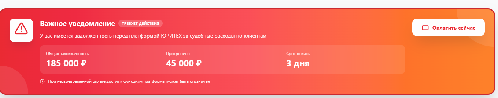

**Что показывает:**  
Крупный баннер с предупреждением о задолженности партнёра перед платформой URITECH за судебные расходы по клиентам. Содержит три ключевых показателя:

- «Общая задолженность 185 000 ₽» — сумма всех неоплаченных судебных расходов по клиентам.
- «Просрочено 45 000 ₽» — часть суммы, по которой срок оплаты уже прошёл.
- «Срок оплаты 3 дня» — сколько дней осталось до ближайшего срока оплаты по неоплаченным счетам.

Дополнительно текстовое пояснение о возможном ограничении функций при неуплате.

**Чьи данные:**  
Только финансовые данные текущего авторизованного партнёра.

**Куда ведёт:**  

- Кнопка **«Оплатить сейчас»** — открывает модальное окно выбора способа оплаты (в рамках дашборда).
- В модальном окне:
  - детализированные суммы (судебные расходы, просроченные платежи, итого к оплате),
  - выбор способа оплаты (банковская карта, СБП, банковский перевод, ЮMoney),
  - информационный блок о безопасности платежей.

**Как считается:**  

- **Общая задолженность** — агрегированная сумма всех неоплаченных судебных расходов по клиентам этого партнёра. Срок оплаты устанавливается в карточке клиента. Срок оплаты партнера вносится в карточку партнера. Считается как количество дней от даты определения суда о назначении процедуры банкротства.
- **Просрочено** — сумма по тем начислениям, у которых текущая дата > срока оплаты. С
- **Срок оплаты** — Количество дней просрочки. Нужно изменить.
- Все суммы и сроки приходят с бэкенда и рассчитываются по данным финансовых операций.

**Если нет данных:**  

- Если задолженности нет (все счета оплачены, нет просрочек), баннер **не отображается**.
- Модальное окно оплаты недоступно (кнопка не показывается).

---

### 1.2 — Карточка «Всего клиентов»

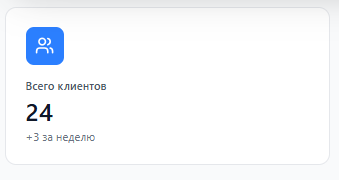

**Что показывает:**  

- Общее количество активных клиентов (дел о банкротстве) партнёра.
- Подпись «+3 за неделю» — сколько новых клиентов было создано за последние 7 календарных дней.

**Чьи данные:**  
Только клиенты текущего партнёра.

**Куда ведёт:**  

- Клик по карточке → переход на страницу **«Клиенты»** со списком всех клиентов без дополнительных фильтров.

**Как считается:**  

- **Всего клиентов** — количество клиентских карточек этого партнёра, кроме архивных/закрытых (по бизнес-правилу).
- **+N за неделю** — число клиентов, созданных за последние 7 дней (по дате создания).

**Если нет данных:**  

- При отсутствии клиентов — показывает **«0»**, подпись с приращением не показывается.

---

### 1.3 — Карточка «ДО подачи в суд»

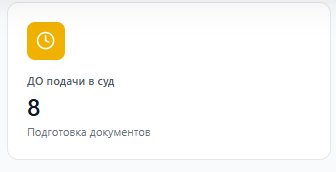

**Что показывает:**  

- Число клиентов на этапах до фактической подачи документов в суд:
  - клиенты в статусах сбора/подготовки документов,
  - клиенты с подготовленными, но ещё не принятыми/не отправленными документами.

**Чьи данные:**  
Только клиенты текущего партнёра.

**Куда ведёт:**  

- Клик по карточке → страница **«Клиенты»** с предустановленным фильтром по типу клиента: «ДО подачи в суд».

**Как считается:**  

- Считаются клиенты со значением типа `before_court` и соответствующими статусами («Новый», «Подготовка документов», «Готов к подаче» и т.п., по статусам в системе).

**Если нет данных:**  

- Показывается **«0»**, дополнительный текст — опционально или скрыт.

---

### 1.4 — Карточка «УЖЕ в суде»

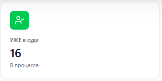

**Что показывает:**  

- Количество клиентов, которые уже находятся на судебных этапах (заявление принято судом, идёт производство и т.п.).

**Чьи данные:**  
Только клиенты текущего партнёра.

**Куда ведёт:**  

- Клик по карточке → страница **«Клиенты»** с фильтром по типу клиента «УЖЕ в суде».

**Как считается:**  

- Считаются клиенты с типом `in_court` (включая стадии от «Документы в суде» до «Процедура завершена/успешно»).

**Если нет данных:**  

- Показывается **«0»**.

---

### 1.5 — Карточка «Успешно завершено»

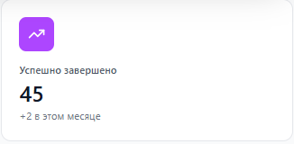

**Что показывает:**  

- Общее количество дел, завершённых успешно.
- Подпись «+2 в этом месяце» — число дел, завершённых в текущем календарном месяце.

**Чьи данные:**  
Только клиенты текущего партнёра.

**Куда ведёт:**  

- Клик по карточке → страница **«Клиенты»** с фильтром по завершённым/архивным делам.

**Как считается:**  

- **Всего** — количество клиентов в статусе «Завершено»/«Архив».
- **+N в этом месяце** — количество дел, для которых дата завершения попадает в текущий месяц.

**Если нет данных:**  

- Показывается **«0»**, подпись про приращение не отображается.

---

### 1.6 — Блок «Срочные задачи»

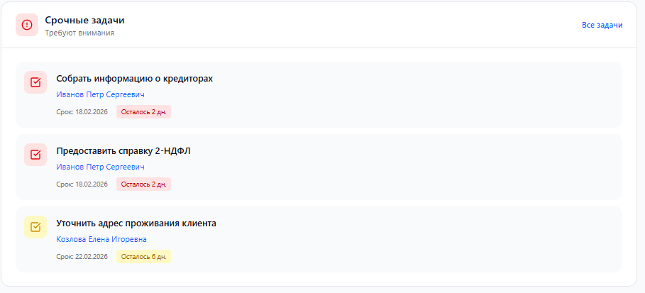

**Что показывает:**  

- Список до 5 ближайших задач, требующих внимания (с высоким или средним приоритетом).
- Для каждой задачи:
  - название задачи,
  - ФИО клиента,
  - срок выполнения,
  - бейдж «Осталось N дн.» с выделением критичных сроков.

**Чьи данные:**  

- Задачи, назначенные:
  - **партнёру** (от URITECH),
  - либо задачи, созданные партнёром для себя/для URITECH (по бизнес-правилу фильтра; в моках — общий список).

**Куда ведёт:**  

- Клик по задаче → открытие карточки клиента (маршрут `/dashboard/clients/:id`), где можно увидеть детали задач этого клиента.
- Ссылка **«Все задачи»** → раздел **«Список задач»** со всеми задачами и фильтрами.

**Как считается:**  

- Берутся все невыполненные задачи (статусы «Ожидает», «В работе», «Просрочено»).
- Из них выбираются срочные/критичные по приоритету и сроку.
- Сортируются по дате дедлайна (ближайшие сверху).
- Ограничение вывода — максимум 5 задач.

**Если нет данных:**  

- Показывается текст **«Нет срочных задач»**.

---

### 1.7 — Блок «Выполнение задач»

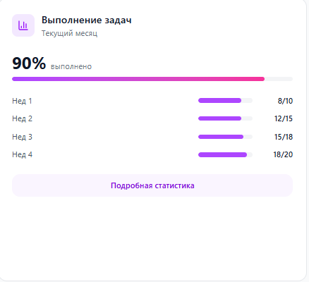

**Что показывает:**  

- Крупный процент выполнения задач за текущий месяц (например, 90%).
- Прогресс-бар по этому проценту.
- Разбивка по неделям:
  - «Нед 1: 8/10»,
  - «Нед 2: 12/15» и т.д.

**Чьи данные:**  

- Задачи, связанные с клиентами данного партнёра (как созданные партнёром, так и назначенные URITECH).

**Куда ведёт:**  

- Кнопка/ссылка **«Подробная статистика»** → раздел **«Список задач»** с расширенными фильтрами и списком задач.

**Как считается:**  

- За текущий календарный месяц:
  - **выполненные задачи** / **все задачи** × 100%.
- По неделям — группировка по дате создания/дедлайна (по выбранному бизнес-правилу).

**Если нет данных:**  

- Показывается **«0%»**, прогресс-бар пустой.

---

### 1.8 — Блок «Последние клиенты»

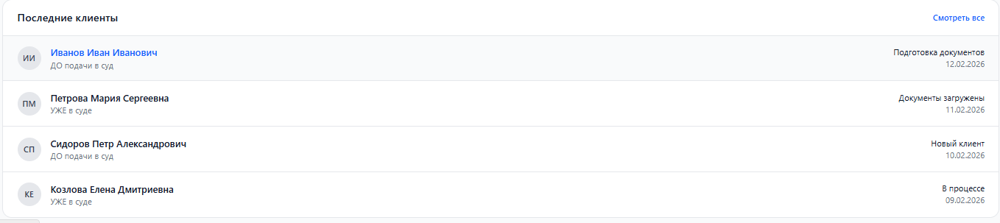

**Что показывает:**  

- Ленту последних добавленных/изменённых клиентов:
  - инициалы (аватар по первым буквам ФИО),
  - полное имя клиента,
  - тип («ДО подачи в суд» / «УЖЕ в суде»),
  - текущий статус (например, «Новый клиент», «Документы загружены», «В процессе»),
  - дата добавления/обновления.

**Чьи данные:**  

- Только клиенты текущего партнёра.

**Куда ведёт:**  

- Клик по строке → **карточка клиента** `/dashboard/clients/:id`.
- Ссылка **«Смотреть все»** → раздел **«Клиенты»**.

**Как считается:**  

- Берётся список клиентов партнёра, сортированный по дате создания/обновления (последние сверху).
- Количество записей ограничено (например, 4–10 последних клиентов).

**Если нет данных:**  

- При отсутствии клиентов — выводится пустое состояние (текст «Клиенты не найдены» или аналогичный).

---

## 2. Клиенты (`ClientsList`)

### 2.1 — Заголовок и действия

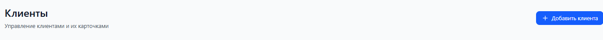

**Что показывает:**  

- Заголовок раздела «Клиенты» и подзаголовок «Управление клиентами и их карточками».
- Кнопка **«Добавить клиента»** ведет на раздел меню "Добавить клиента" и создает карточку клиента 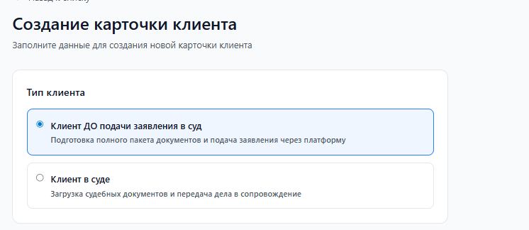 

**Чьи данные:**  

- Кнопка доступна партнёру, который может добавлять новых клиентов.

**Куда ведёт:**  

- Кнопка **«Добавить клиента»** → форма создания клиента: `/dashboard/clients/new`.

**Как считается:**  

- Нет вычисляемых чисел.

**Если нет данных:**  

- Блок всё равно отображается; ниже список клиентов может быть пустым.

---

### 2.2 — Фильтры и поиск

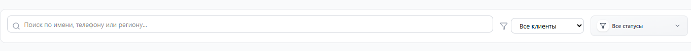

**Что показывает:**  

- **Поиск** по:
  - ФИО клиента,
  - телефону,
  - региону.
- **Фильтр по типу клиента:**
  - Все клиенты,
  - ДО подачи в суд,
  - В суде.
- **Продвинутый фильтр по статусам** в виде дропдауна с группировкой по этапам процедуры:
  - Этап 1: Сбор документов,
  - Этап 2: Формирование документов,
  - Этап 3: Отправка в суд,
  - Этап 4: Принятие документов,
  - Этап 5: Ожидание заседания.
  Внутри каждого этапа — конкретные статусы (например, «Загрузка документов», «Генерация документов», «Ожидание принятия» и т.д.).
- Кнопка **«Сбросить фильтры»**, когда фильтры активны.

**Чьи данные:**  

- Клиенты текущего партнёра.

**Куда ведёт:**  

- Фильтры не ведут на другие страницы, а обновляют список клиентов на текущей.

**Как считается:**  

- **Поиск** — по вхождению строки в ФИО, телефон или регион.
- **Тип клиента** — фильтрация по полю `type` (`before_court` / `in_court`).
- **Статус** — фильтрация по коду статуса (по одной из групп).
- При сбросе — отображаются все клиенты партнёра.

**Если нет данных:**  

- При применённых фильтрах и отсутствии результатов — сообщение **«Клиенты не найдены»**.

---

### 2.3 — Список клиентов (таблица/список карточек)

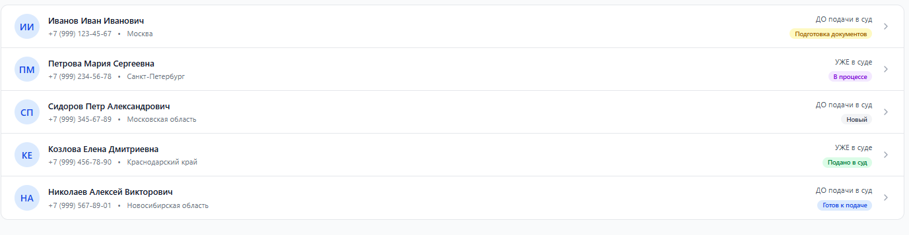

**Что показывает:**  

Для каждого клиента:

- Инициалы (круглый аватар с 2 буквами),
- Полное ФИО,
- Телефон и регион,
- Тип клиента:
  - «ДО подачи в суд» / «В суде»,
- Статус с цветным бейджем (например, «Подготовка документов», «Отправлено в суд», «Приняты судом» и т.д.).

**Чьи данные:**  

- Только клиенты текущего партнёра.

**Куда ведёт:**  

- Клик по строке клиента → **карточка клиента** `/dashboard/clients/:id`, где отображаются подробные данные, статусы, прогресс-бар и история задач/документов (по дальнейшей реализации).

**Как считается:**  

- Список формируется по данным бэкенда с учётом активных фильтров и поиска.
- Текст статуса и цвет берутся из маппинга кодов статуса на человекочитаемые названия и стилевые классы.

**Если нет данных:**  

- При отсутствии клиентов вообще — показывается сообщение **«Клиенты не найдены»**.
- При наличии клиентов, но пустой выборке по фильтрам — аналогичное сообщение.

---

## 3. Добавить клиента (`ClientForm`)
Создание карточки клиента


**Что показывает:**  

- Форму создания новой карточки клиента, включающую:
  - клиент до подачи заявления в суд
  - клиент в суде

**Чьи данные:**  

- Партнер вводит данные по своему клиенту. Выбирает между "клиент до суда" и "клиент в суде".

**Куда ведёт:**  

- Форма заполнения данных по клиенту


**Если нет данных:**  

- Клиент не передается

### 3.1 - Клиент до суда

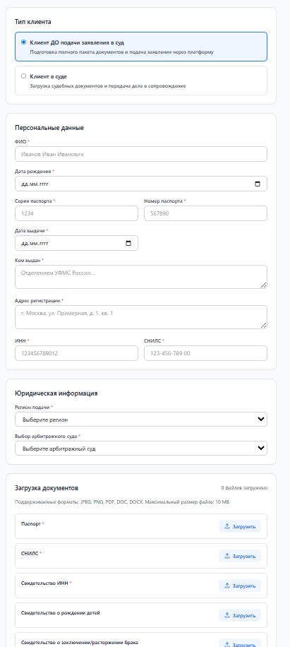

**Что показывает:**  

- Форму карточки клиента до суда, включающую:
  - персональные данные (ФИО, контакты),
  - документы (паспорт, ИНН, СНИЛС и т.д.),
  - тип клиента: «ДО подачи в суд» 
  - базовую информацию по делу (регион, суд и т.п. — по дизайну).

**Чьи данные:**  

- Вводимые данные относятся к новому клиенту текущего партнёра.

**Куда ведёт:**  

- После успешного заполнения и отправки формы:
  - создаётся новый клиент,
  - партнёр перенаправляется в **карточку клиента** или в список клиентов (по бизнес-правилу навигации).

### 3.2 Клиент в суде

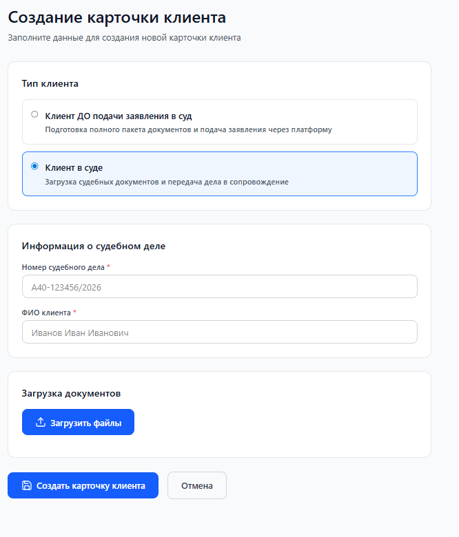

**Что показывает:**  

- Форму карточки клиента в суде, включающую:
  - Номер судебного дела
  - персональные данные (ФИО, контакты),
 

**Чьи данные:**  

- Вводимые данные относятся к новому клиенту текущего партнёра.

**Куда ведёт:**  

- После успешного заполнения и отправки формы:
  - создаётся новый клиент,
  - партнёр перенаправляется в **карточку клиента** или в список клиентов (по бизнес-правилу навигации).
---

## 4. Список задач (`TasksList`)

### 4.1 — Заголовок и создание задачи

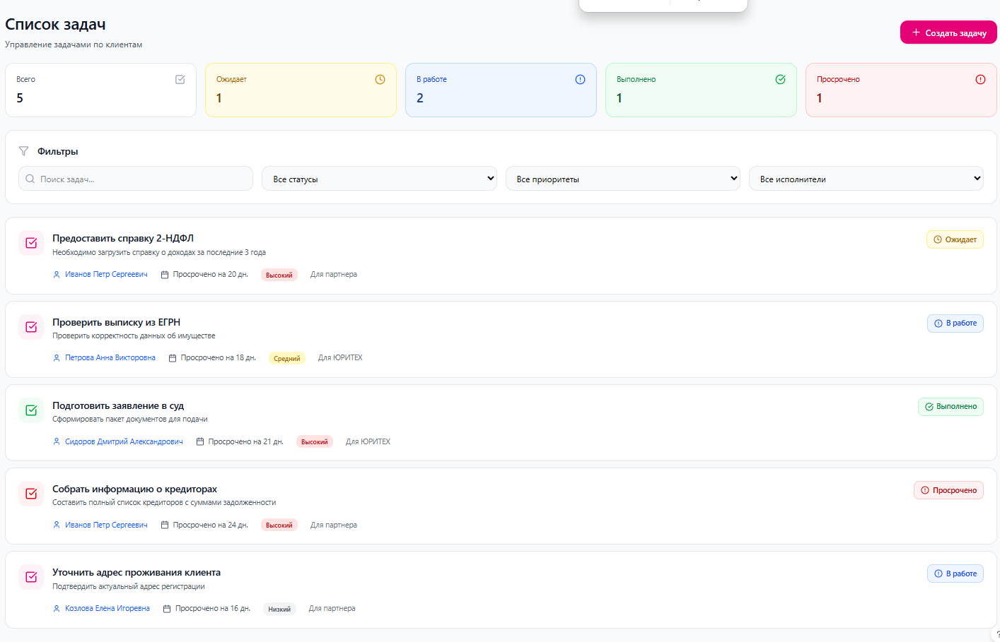

**Что показывает:**  

- Заголовок «Список задач» и подзаголовок «Управление задачами по клиентам». 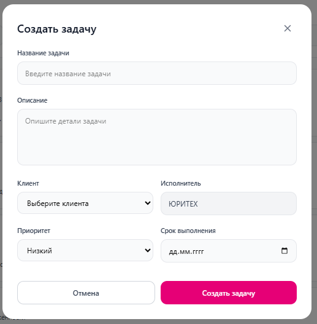
- Кнопка **«Создать задачу»**, открывающая модальное окно с формой новой задачи. 
Задачи по умолчанию партнер ставит на ЮРИТЕХ(админ). По одному из своих клиентов.

**Чьи данные:**  

- Задачи, связанные с клиентами данного партнёра:
  - назначенные URITECH партнёру,
  - созданные партнёром на URITECH.

**Куда ведёт:**  

- Кнопка **«Создать задачу»** → модальное окно с формой:
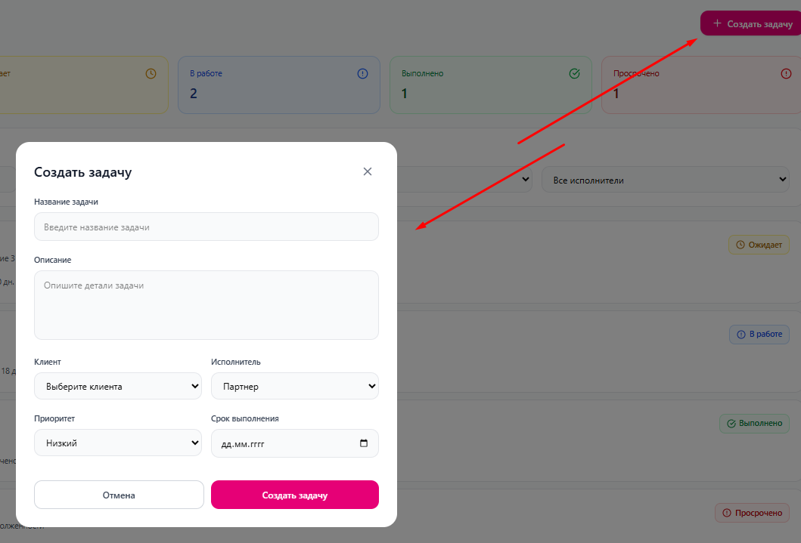
  - выбор клиента,
  - название, описание, приоритет, срок выполнения.

**Как считается:**  

- При создании задачи задаётся статус «Ожидает» (или другой по логике бэкенда).

**Если нет данных:**  

- При отсутствии задач отображается пустое состояние (см. ниже 4.4).

---

### 4.2 — Карточки статистики по задачам

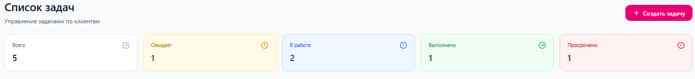

**Что показывает:**  

Пять компактных карточек:

- **Всего** — общее количество задач.
- **Ожидает** — задачи в статусе `pending`.
- **В работе** — статус `in_progress`.
- **Выполнено** — статус `completed`.
- **Просрочено** — статус `overdue`.

**Чьи данные:**  

- Задачи, относящиеся к клиентам этого партнёра.

**Куда ведёт:**  

- Сами карточки могут использоваться визуально; базовый сценарий — без перехода (дополнительно можно связать с фильтрами по статусу).

**Как считается:**  

- Для каждой категории считается число задач с соответствующим статусом.

**Если нет данных:**  

- При полном отсутствии задач все значения — **0**.

---

### 4.3 — Фильтры и поиск

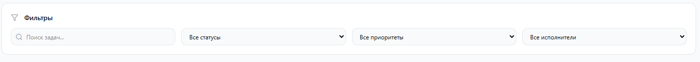

**Что показывает:**  

- **Поиск** по названию задачи и имени клиента.
- **Фильтр по статусу**:
  - Все,
  - Ожидает,
  - В работе,
  - Выполнено,
  - Просрочено.
- **Фильтр по приоритету**:
  - Все,
  - Низкий,
  - Средний,
  - Высокий.
- **Фильтр по исполнителю**:
  - Все,
  - Для партнёра,
  - Для URITECH.
- Кнопка **«Сбросить фильтры»**, если выбран хотя бы один фильтр или введён поиск.

**Чьи данные:**  

- Задачи текущего партнёра.

**Куда ведёт:**  

- Фильтры обновляют список задач на текущей странице.

**Как считается:**  

- Фильтрация по полям задачи (`status`, `priority`, `assignedTo`) и строкам поиска (`title`, `client.name`).

**Если нет данных:**  

- При отсутствии задач после фильтрации — блок пустого состояния **«Задачи не найдены»**.

---

### 4.4 — Список задач

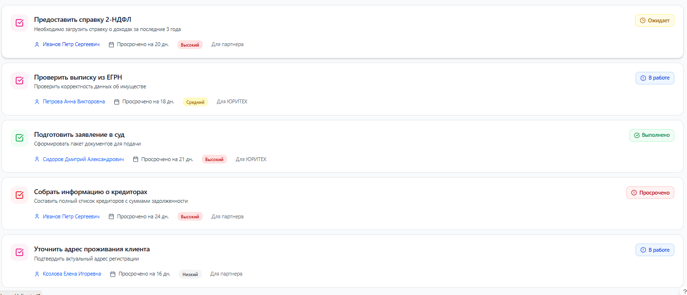

**Что показывает:**  

Для каждой задачи:

- Название и описание,
- Статус задачи (с цветным бейджем и иконкой),
- Клиент (ФИО) с ссылкой в карточку клиента,
- Срок (иконка календаря + текст «Сегодня», «Завтра», «Осталось N дн.» или «Просрочено на N дн.»),
- Приоритет (бейдж «Низкий/Средний/Высокий»),
- Исполнитель («Для партнёра» / «Для URITECH»).

**Чьи данные:**  

- Все задачи по клиентам данного партнёра.

**Куда ведёт:**  

- Клик по имени клиента → карточка клиента `/dashboard/clients/:id`.
- Дальнейшая детализация задачи может быть реализована отдельным экраном (по задаче/карточке клиента).

**Как считается:**  

- Расчёт оставшихся дней до дедлайна из даты `dueDate` и текущей даты:
  - < 0 — «Просрочено на N дн.»,
  - = 0 — «Сегодня»,
  - = 1 — «Завтра»,
  - > 1 — «Осталось N дн.».
- Цвет и текст статуса берутся из маппинга по статусу.

**Если нет данных:**  

- Показан блок с иконкой и текстом **«Задачи не найдены»**.

---

## 5. Финансы (`CourtFees`)

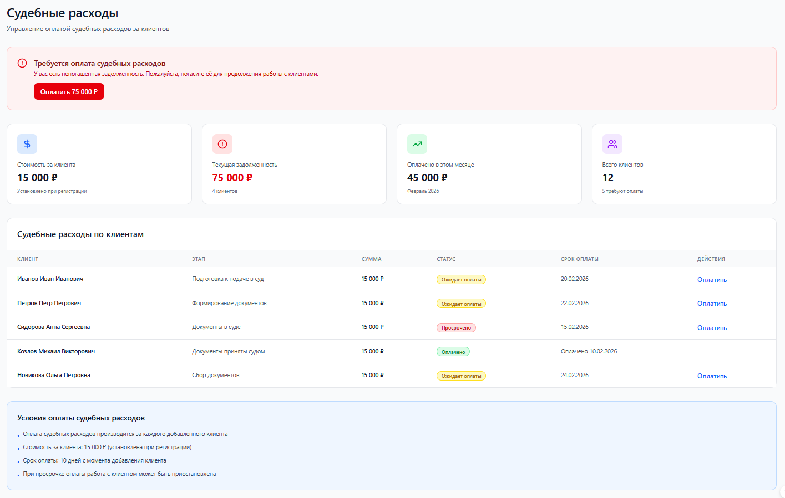

**Что показывает:**  

- Баннер-предупреждение при наличии задолженности (с суммой и кнопкой оплаты).
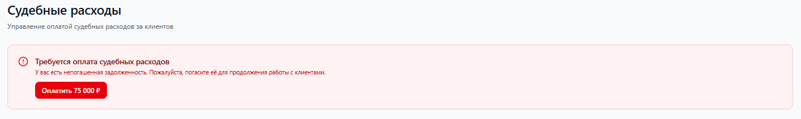
Расчитывается как сумма начисленных судебных расходов, превысивших срок оплаты. Оплата должна поступать в течение 10 дней после назначения судом процедуры банкротства. Дата назначения процедуры вносится вручную администратором Юритех в карточку клиента. 
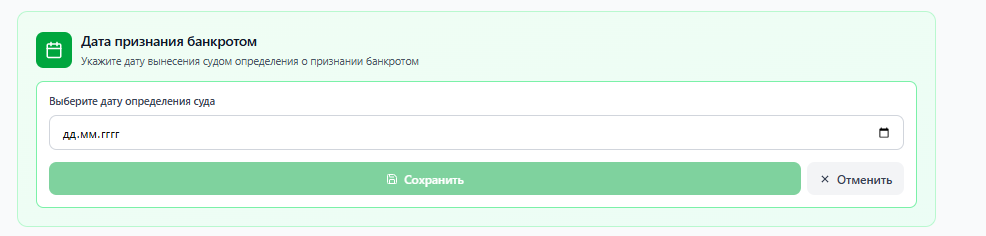 панель Администратора, карточка клиента

- Сводные карточки:
  - стоимость судебных расходов за одного клиента (установлено при регистрации партнёра), 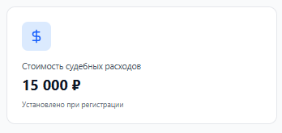
  - сумма оплачено в текущем месяце - сумма поступлений в текущем месяце 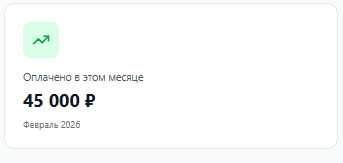
  - текущая задолженность - дублируется информация с банера 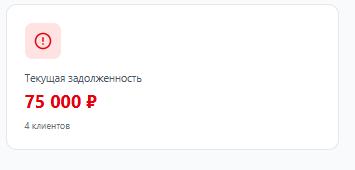
  - оплачено в этом месяце - общая сумма оплат судебных расходов в этом месяце 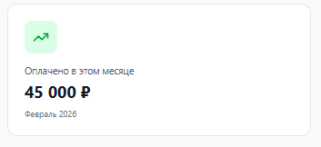
  - всего клиентов, требующих оплаты. Общее число клиентов по которым не произведена оплата. 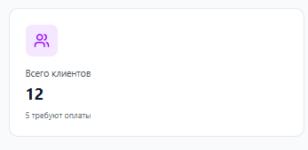

- Таблицу по клиентам с судебными расходами: 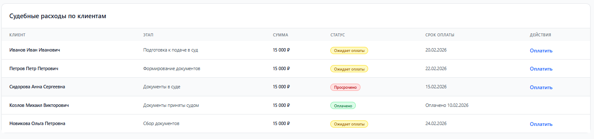
  - ФИО клиента,
  - текущий этап,
  - сумма судебных расходов,
  - статус («Оплачено», «Ожидает оплаты», «Просрочено»),
  - дата/срок оплаты,
  - кнопка «Оплатить» для неоплаченных.
- Информационный блок «Условия оплаты судебных расходов».

**Чьи данные:**  

- Финансовые данные по клиентам текущего партнёра.

**Куда ведёт:**  

- Кнопка «Оплатить … ₽» / «Оплатить» в таблице → сценарий оплаты (в текущей версии — триггер начала платёжного процесса; детали реализуются через интеграцию с платёжным шлюзом).
- Внешняя навигация не требуется, всё в рамках раздела.

**Как считается:**  

- **Стоимость за клиента** — фиксированная, задана при регистрации партнёра.
- **Текущая задолженность** — сумма по клиентам в статусе «Ожидает оплаты» + «Просрочено».
- **Оплачено в этом месяце** — сумма всех успешных платежей за текущий месяц.
- Таблица формируется по списку клиентов с привязкой к их судебным расходам и статусам оплаты.

**Если нет данных:**  

- Если задолженности нет, баннер-предупреждение не показывается, карточка «Текущая задолженность» может быть с «0 ₽» и нейтральным текстом.
- Если ни одному клиенту не были начислены судебные расходы — таблица пустая с текстом «Нет данных о судебных расходах».

Остальные разделы в "Финансы" удалены

## 6. Прогресс-бар статусов (`ClientProgress`)

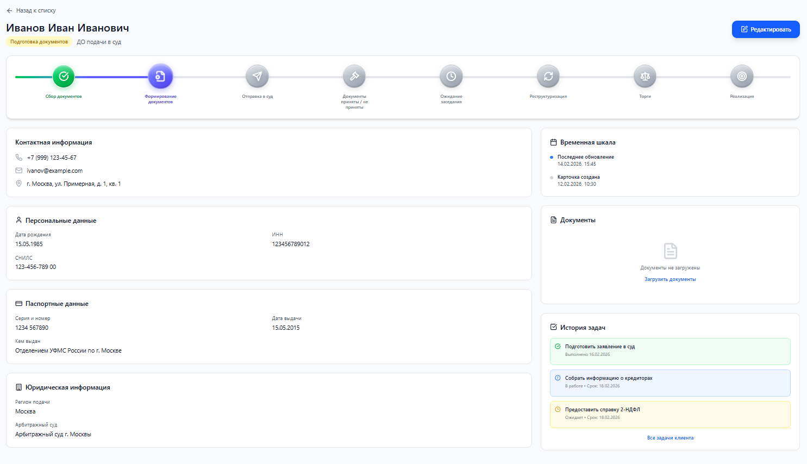

**Что показывает:**  

- Общий прогресс по всем этапам процедуры банкротства конкретного клиента (%).
- Горизонтальный степпер по основным этапам:
  1. Сбор документов,
  2. Формирование документов,
  3. Отправка в суд,
  4. Документы приняты / не приняты,
  5. Ожидание заседания.
- Детализацию активного этапа:
  - список подэтапов (например, «Загрузка документов», «Генерация», «Проверка», «Готово»),
  - статус каждого (завершено / в процессе / ожидает / отклонено),
  - при наличии — дата и время, комментарий, прогресс в % по шагу.
- Легенду статусов (Завершено, В процессе, Ожидает, Отклонено).

**Чьи данные:**  

- Статусы и подэтапы конкретного клиента.

**Куда ведёт:**  

- Прогресс-бар и блок статусов находятся внутри карточки клиента; переходов на другие страницы не требуется.
- Клик по этапу в горизонтальном степпере переключает активный этап и его детализацию.

**Как считается:**  

- **Общий прогресс** — отношение количества завершённых подэтапов ко всем подэтапам по всем этапам клиента.
- Статус этапа (иконка и цвет) определяется по подэтапам:
  - все подэтапы завершены → «Завершено»,
  - есть отклонённые → «Отклонено»,
  - есть подэтап «в процессе» → «В процессе»,
  - иначе — «Ожидает».

**Если нет данных:**  

- Если для клиента этапы ещё не инициализированы — прогресс может быть 0%, этапы отмечены как «Ожидает».
- Можно показывать заглушку «Прогресс по клиенту ещё не инициализирован».

---

## 7. Обучение (`Training`)

### 7.1 — Вкладка «Видеоинструкции»

*(скриншот элемента)*

**Что показывает:**  

- Сетку карточек видео:
  - превью,
  - заголовок (например, «Введение в платформу ЮРИТЕХ Partner»),
  - описание (о чём видео),
  - длительность.
- Наведение мыши — подсветка, иконка «Play».

**Чьи данные:**  

- Типовой набор обучающих видеороликов от URITECH.

**Куда ведёт:**  

- Клик по карточке — запуск проигрывания видео (реализуется при интеграции с видеосервисом или встроенным плеером).

**Как считается:**  

- Статических вычислений нет, данные приходят с бэкенда (список видеороликов).

**Если нет данных:**  

- Можно показать текст: «Видео пока недоступны» и/или ссылку на внешний ресурс.

---

### 7.2 — Вкладка «Частые вопросы» (FAQ)

*(скриншот элемента)*

**Что показывает:**  

- Список аккордеонов с вопросом и ответом:
  - пример: «Как добавить нового клиента в систему?», «Какие форматы документов поддерживаются?» и т.д.
- При клике по вопросу раскрывается ответ.

**Чьи данные:**  

- Статический/редактируемый контент от URITECH.

**Куда ведёт:**  

- В рамках раздела, без навигации.

**Как считается:**  

- Нет числовых расчётов.

**Если нет данных:**  

- Можно показать заглушку «FAQ будет добавлен позже».

---

### 7.3 — Вкладка «Важно»

*(скриншот элемента)*

**Что показывает:**  

- Карточки с важными предупреждениями:
  - «Своевременная оплата»,
  - «Проверка данных клиента»,
  - «Конфиденциальность»,
  - «Сроки выполнения задач».
- Для каждой — иконка, заголовок и текст описания.

**Чьи данные:**  

- Информационные сообщения от URITECH.

**Куда ведёт:**  

- Не ведёт на другие страницы.

**Как считается:**  

- Нет вычислений.

**Если нет данных:**  

- Раздел может быть скрыт или отображать заглушку.

---

### 7.4 — Вкладка «Инструкции»

*(скриншот элемента)*

**Что показывает:**  

- Набор текстовых инструкций с шагами:
  - «Первые шаги в системе»,
  - «Работа с клиентом "ДО подачи в суд"»,
  - «Работа с клиентом "УЖЕ в суде"»,
  - «Ежемесячные действия».
- Каждая инструкция — список шагов с нумерацией.

**Чьи данные:**  

- Методические материалы URITECH.

**Куда ведёт:**  

- Остаётся в рамках раздела обучения.

**Как считается:**  

- Нет числовых расчётов.

**Если нет данных:**  

- Раздел может быть скрыт или заменён заглушкой.

---

## 8. Чат (`Chat`)

*(скриншот элемента)*

**Что показывает:**  

- Список доступных чатов слева:
  - «Арбитражный управляющий»,
  - «Помощник АУ»,
  - «Нейропомощник».
- Основное окно чата справа:
  - история переписки в формате сообщений (с отправителем, текстом, временем),
  - разделение по цвету на сообщения партнёра и собеседника (или бота),
- Поле ввода сообщения и кнопка **«Отправить»**.

**Чьи данные:**  

- Сообщения текущего партнёра и ответов:
  - от арбитражного управляющего,
  - от его помощника,
  - от нейропомощника (AI).

**Куда ведёт:**  

- Выбор чата слева переключает активный диалог.
- Отдельных переходов на другие страницы нет.

**Как считается:**  

- Время сообщения выставляется по текущему времени клиента.
- Имитируется или реализуется логика ответа (для нейропомощника — через интеграцию с AI).

**Если нет данных:**  

- При отсутствии сообщений в чате — можно отобразить пустое состояние «Сообщений пока нет, напишите первое».

---

## 9. Документы (`Documents`)

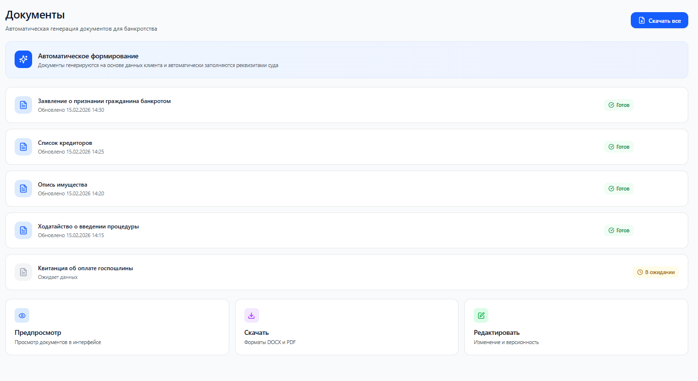

**Что показывает:**  

- Заголовок раздела «Документы» и подзаголовок «Автоматическая генерация документов для банкротства».
- Кнопку **«Скачать все»** для массовой загрузки готовых документов.
- Информационный баннер об автоматическом формировании документов на основе данных клиента и реквизитов суда.
- Список документов по делу о банкротстве:
  - Заявление о признании гражданина банкротом,
  - Список кредиторов,
  - Опись имущества,
  - Ходатайство о введении процедуры,
  - Квитанция об оплате госпошлины и др.
- Для каждого документа:
  - название,
  - статус («Готов» / «В ожидании»),
  - дата последнего обновления,
  - действия: предпросмотр, редактирование, скачивание (для готовых документов).
- Блок действий: Предпросмотр, Скачать (DOCX/PDF), Редактировать.

**Чьи данные:**  

- Документы, сформированные по клиентам текущего партнёра.

**Куда ведёт:**  

- Кнопка «Скачать все» → загрузка архива со всеми готовыми документами.
- Кнопки «Предпросмотр», «Редактировать», «Скачать» по каждому документу → соответствующие действия в рамках раздела или модального окна.
- Раздел привязан к контексту клиента (при переходе из карточки клиента — документы этого клиента).

**Как считается:**  

- Статус «Готов» — документ сформирован на основе заполненных данных клиента.
- Статус «В ожидании» — не хватает данных для генерации (например, квитанция до оплаты госпошлины).
- Дата обновления — момент последней генерации/изменения документа.

**Если нет данных:**  

- При отсутствии клиента или незаполненных данных — список документов с преимущественно статусом «В ожидании».
- Можно показать заглушку «Документы будут доступны после заполнения данных клиента».

---

## ЧАСТЬ 2: АДМИН-ПАНЕЛЬ (URITECH)

> Что видит пользователь с ролью «администратор» (URITECH).  
> Свои страницы, своё боковое меню, свой дашборд.

---

## 1. Дашборд администратора (`AdminDashboard`)
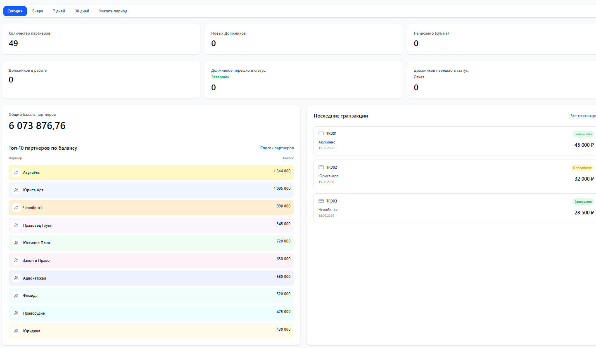

### 1.1 — Вкладки периодов

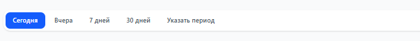

**Что показывает:**  

- Набор предустановленных периодов для аналитики:
  - «Сегодня»,
  - «Вчера»,
  - «7 дней»,
  - «30 дней»,
  - «Указать период» (произвольный интервал).
- Активный период подсвечен, по нему пересчитывается вся статистика ниже.

**Чьи данные:**  

- Общая статистика по **всем партнёрам и их должникам** на платформе URITECH.

**Куда ведёт:**  

- Клик по одному из периодов обновляет данные в блоках:
  - «Основная статистика»,
  - «Статистика движения должников»,
  - «Последние транзакции»,
  - а также в других виджетах, если они завязаны на период.
- Клик по «Указать период» открывает модальное окно выбора дат.

**Как считается:**  

- При выборе фиксированных периодов («Сегодня», «Вчера», «7/30 дней») бэкенд возвращает агрегированную статистику за соответствующий интервал.
- При выборе «Указать период» администратор вручную задаёт **дату начала** и **дату окончания**, после чего применяется пользовательский диапазон.

**Если нет данных:**  

- Если за выбранный период нет событий (новых должников, начислений, транзакций), значения статистики могут быть 0 либо блоки показывают текст «Данные не найдены».

---

### 1.2 — Модальное окно выбора периода

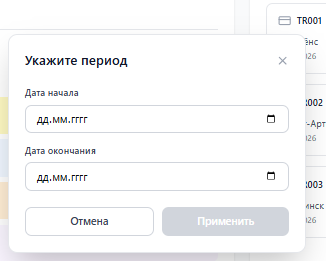

**Что показывает:**  

- Заголовок «Укажите период».
- Два поля ввода:
  - «Дата начала»,
  - «Дата окончания» (не раньше даты начала).
- Кнопки «Отмена» и «Применить».

**Чьи данные:**  

- Локальные настройки фильтрации статистики для текущего администратора (не влияет на других пользователей).

**Куда ведёт:**  

- Кнопка **«Применить»**:
  - закрывает модальное окно,
  - устанавливает период фильтрации,
  - обновляет данные дашборда.
- Кнопка **«Отмена»** закрывает модальное окно без сохранения изменений.

**Как считается:**  

- После выбора периода клиент/бэкенд пересчитывает все агрегаты, ограничивая данные указанным интервалом (по дате создания/изменения должников, начислений, транзакций и т.п.).

**Если нет данных:**  

- Если администратор не указал обе даты, кнопка «Применить» должна быть неактивна.

---

### 1.3 — Блок «Основная статистика»

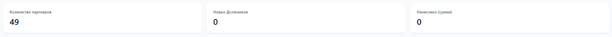

**Что показывает:**  
Три карточки с ключевыми метриками по выбранному периоду:

- «Количество партнеров» — сколько партнёров зарегистрировано в системе.
- «Новых Должников» — сколько новых должников (клиентов) было создано за выбранный период.
- «Начислено (сумма)» — сумма начислений судебных расходов за выбранный период по всем должникам (клиентам).

**Чьи данные:**  

- Сводные данные по всем партнёрам и их должникам на платформе.

**Куда ведёт:**  

- По умолчанию карточки информативные, без переходов. Дополнительно можно привязать переходы к деталям (например, к списку партнёров или к реестру должников за период).

**Как считается:**  

- Все значения считаются по данным бэкенда за выбранный период:
  - «Количество партнеров» — количество записей в справочнике партнёров (с учётом фильтров по статусу, если они применяются).
  - «Новых Должников» — количество новых записей о должниках, созданных в период.
  - «Начислено (сумма)» — сумма всех начислений за этот период (включая по всем партнёрам).

**Если нет данных:**  

- Показаны значения «0» и/или «0 ₽».

---

### 1.4 — Блок «Статистика движения должников»

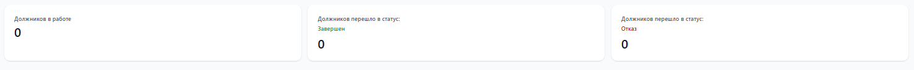

**Что показывает:**  
Набор карточек с динамикой по статусам должников:

- «Должников в работе» — сколько должников (клиентов) на текущий момент находятся в активной работе по всем партнерам.
- «Должников перешло в статус: Завершен» — сколько должников за выбранный период сменили статус на «Завершен».
- «Должников перешло в статус: Отказ» — сколько должников за выбранный период получили статус «Отказ».

**Чьи данные:**  

- Данные по всем должникам на платформе, агрегированные для администратора URITECH.

**Куда ведёт:**  

- По умолчанию статистика информационная. Дополнительно возможен переход к списку должников, отфильтрованных по соответствующим статусам и периоду.

**Как считается:**  

- «Должников в работе» — количество должников в наборах статусов, которые считаются активными (по бизнес-правилу).
- «Перешло в статус ...» — число уникальных должников, у которых в течение выбранного периода произошёл переход в указанный статус.

**Если нет данных:**  

- Для конкретного показателя отображается «0».

---

### 1.5 — Блок «Общий баланс партнеров и Топ‑10»

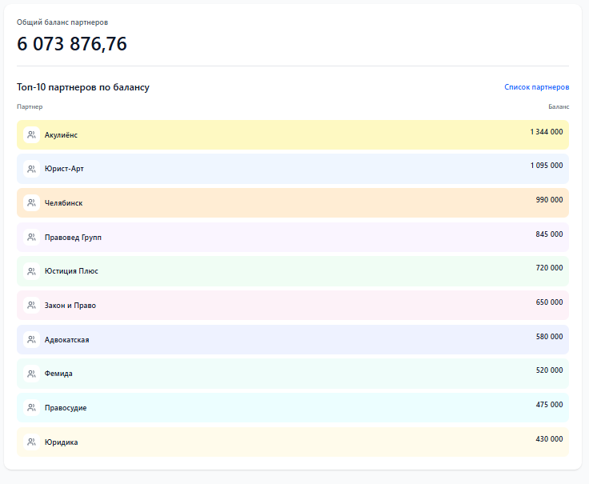

**Что показывает:**  

- Крупную сумму «Общий баланс партнеров» — показывает общую сумму задолженности по судебным расходам по всем партнерам.
- Таблицу/список «Топ‑10 партнеров по балансу»:
  - название партнёра,
  - его задолженность по судебным расходам,
  - визуальное выделение цветом фона строки (разные цвета для разных строк).

**Чьи данные:**  

- Финансовые данные по всем партнёрам URITECH.

**Куда ведёт:**  

- Кнопка/ссылка **«Список партнеров»** → раздел **«Партнёры»** (`AdminPartners`).
- Внутри топ‑10 возможен клик по партнёру → детальная карточка партнёра (по отдельному маршруту `/admin/dashboard/partners/:id`).

**Как считается:**  

- «Общий баланс партнеров» — сумма полей баланса всех партнёров (например, общая задолженность или остаток).
- Топ‑10 формируется сортировкой партнёров по убыванию баланса и выбором первых 10.

**Если нет данных:**  

- Общий баланс = 0, список партнёров пустой или с заглушкой «Данные не найдены».

---

### 1.6 — Блок «Последние транзакции»

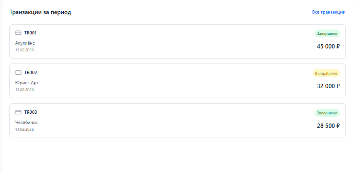

**Что показывает:**  
Список из 10 последних транзакции партнеров за выбранный период

- Список последних финансовых транзакций:
  - ID транзакции,
  - партнёр,
  - сумма,
  - дата,
  - статус («Завершено» / «В обработке»).

**Чьи данные:**  

- Финансовые операции по всем партнёрам за последние дни (или ограниченный список по выбранному периоду).

**Куда ведёт:**  

- Кнопка **«Все транзакции»** → детальный раздел реестра транзакций (может быть реализован отдельно).

**Как считается:**  

- Список заполняется последними транзакциями, отсортированными по дате (самые новые сверху) и ограниченными по количеству (например, 10–20 записей).

**Если нет данных:**  

- Показано пустое состояние «Данные не найдены».

---

## 2. Все клиенты (`AdminClients`)

### 2.1 — Заголовок и добавление должника

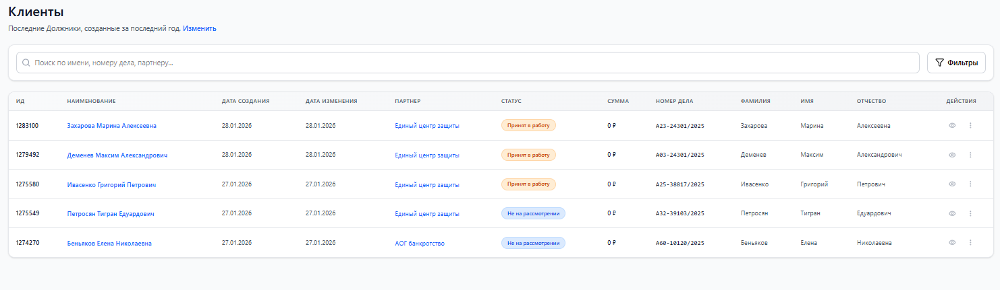

**Что показывает:**  

- Заголовок «Должники».
- Подзаголовок: «Последние Должники, созданные за последний год. [Изменить]» — пояснение текущего периода выборки с возможностью его изменить.


### 2.2 — Поиск и фильтры по должникам

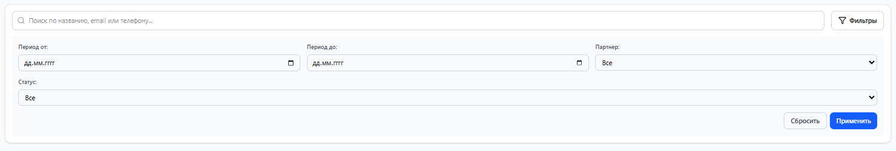

**Что показывает:**  

- Поле поиска с подсказкой: «Поиск по имени, номеру дела, партнеру...». 
- Кнопку **«Фильтры»** (дополнительные фильтры по статусам, партнёрам, суммам и т.п. — по дальнейшей реализации).

**Чьи данные:**  

- Список должников всех партнёров.

**Куда ведёт:**  

- Поиск и фильтры работают в пределах текущей страницы и обновляют таблицу должников.

**Как считается:**  

- Поиск фильтрует список по вхождению строки в:
  - ФИО должника,
  - номер дела,
  - название партнёра и др.
- Кнопка «Фильтры» открывает или будет открывать панель с расширенными фильтрами.

**Если нет данных:**  

- При отсутствии результатов по поиску/фильтрам — таблица без строк, с текстом «Данные не найдены» (по дальнейшей реализации).

---

### 2.3 — Таблица должников

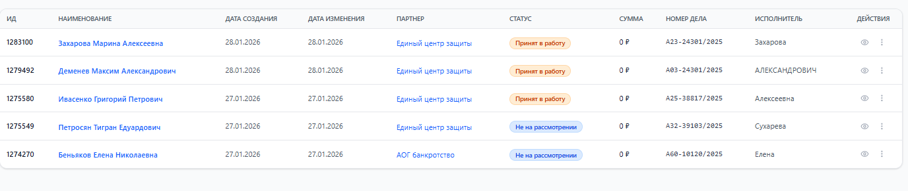

**Что показывает:**  

Таблицу с ключевыми полями по должникам:

- ИД (внутренний идентификатор),
- Наименование (ФИО должника),
- Дата создания,
- Дата изменения,
- Партнёр (название с ссылкой в карточку партнёра),
- Статус (с цветным бейджем и цветом по статусу),
- Сумма (например, сумма задолженности или задолженность по делу),
- Номер дела (арбитражный номер),
- Фамилия / Имя / Отчество (разнесённые по отдельным колонкам),
- Действия (просмотр/меню).

**Чьи данные:**  

- Все должники платформы по выбранным фильтрам/периоду.

**Куда ведёт:**  

- Клик по ФИО должника → детальная карточка должника `/admin/dashboard/debtors/:id`.
- Клик по партнёру → детальная карточка партнёра `/admin/dashboard/partners/:partnerId`.
- Иконка «глаз» в столбце «Действия» → просмотр должника.
- Кнопка «три точки» → контекстное меню с дополнительными действиями (изменить, удалить и т.д., по дальнейшей реализации).

**Как считается:**  

- Статус должника отображается текстом и цветовым кодом (оранжевый, синий, зелёный, красный и т.д.), соответствующим бизнес‑статусам.
- Сумма и другие поля берутся напрямую из карточки должника.

**Если нет данных:**  

- Если в выборке нет ни одного должника — таблица пустая, отображается сообщение о том, что «Должники не найдены» (по реализации).

---

## 3. Партнёры (`AdminPartners`)

### 3.1 — Заголовок и добавление партнёра

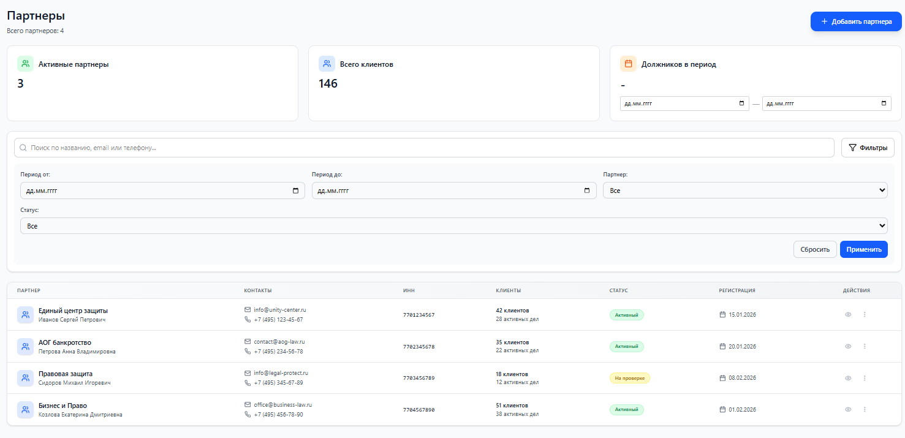

**Что показывает:**  

- Заголовок «Партнеры».
- Подзаголовок «Всего партнеров: N» — количество всех партнёров URITECH.
- Кнопку **«Добавить партнера»**. 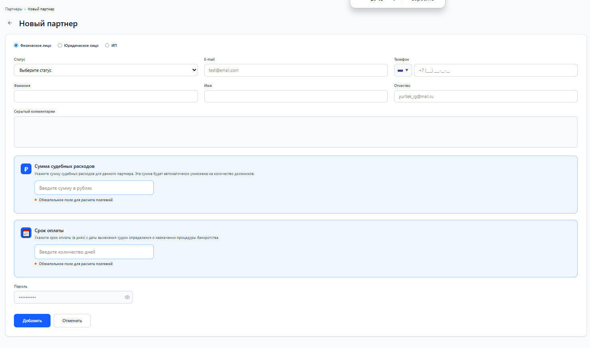

**Чьи данные:**  

- Справочник всех партнёров, работающих с платформой URITECH.

**Куда ведёт:**  

- Кнопка **«Добавить партнера»** → форма регистрации нового партнёра `/admin/dashboard/partners/new`.

**Как считается:**  

- «Всего партнеров: N» — количество записей в справочнике партнёров.

**Если нет данных:**  

- При отсутствии партнёров N = 0, таблица ниже пустая.

---

### 3.2 — Блок статистики по партнёрам

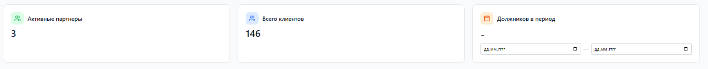

**Что показывает:**  
Набор карточек со сводными показателями:

- «Активные партнеры» — количество партнёров в активном статусе.
- «Всего клиентов» — суммарное количество клиентов по всем партнёрам.
- «Должников (клиентов) в период» — сколько должников было добавлено всеми партнёрами за выбранный фильтрами период.

**Чьи данные:**  

- Аггрегированные данные по всем партнёрам.

**Куда ведёт:**  

- Карточки носят информативный характер; дополнительно можно привязать переходы к фильтрованным спискам партнёров/должников.

**Как считается:**  

- «Активные партнёры» — количество партнёров со статусом «Активный».
- «Всего клиентов» — сумма полей `clients` по всем партнёрам.
- «Активных дел» — сумма полей `activeCases` по всем партнёрам.
- «Должников в период» — считается на основе массива `debtorsAdded` по всем партнёрам и выбранных дат «от» и «до»:
  - количество добавленных должников в каждой записи,
  - учитываются только те записи, чья дата попадает в интервал.

**Если нет данных:**  

- Если даты периода не заданы — отображается «-» и подсказка «Выберите период».
- При отсутствии партнёров — все числа 0.

---

### 3.3 — Поиск и фильтры по партнёрам


**Что показывает:**  

- Поиск по полям:
  - название партнёра,
  - email,
  - телефон.
- Кнопку **«Фильтры»**, раскрывающую панель с:
  - периодом «от» и «до» для расчёта «должников в период»,
  - фильтром по статусу (Все / Активный / На проверке),
  - кнопкой **«Закрыть»**.

**Чьи данные:**  

- Список всех партнёров.

**Куда ведёт:**  

- Поиск и фильтры работают в пределах текущей страницы и обновляют таблицу партнёров.

**Как считается:**  

- Поиск — по вхождению строки в название, email или телефон.
- Фильтры по дате и статусу задают условия для:
  - расчёта «должников в период»,
  - опционально — для отбора партнёров по времени регистрации и статусу.

**Если нет данных:**  

- При отсутствии результатов — таблица пустая, можно отобразить текст «Партнеры не найдены».

---

### 3.4 — Таблица партнёров

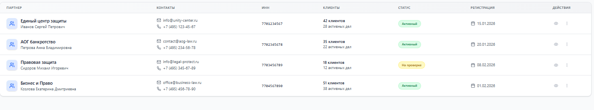

**Что показывает:**  

Таблицу с основными полями по каждому партнёру:

- Партнёр (название + ФИО директора, иконка/аватар),
- Контакты (email и телефон с иконками),
- ИНН,
- Клиенты (количество клиентов и активных дел),
- Статус (с цветным бейджем: активный, на проверке и т.п.),
- Регистрация (дата подключения партнёра),
- Действия (просмотр и меню).

**Чьи данные:**  

- Список партнёров URITECH с учётом поискового запроса и фильтров.

**Куда ведёт:**  

- Клик по названию партнёра → карточка партнёра `/admin/dashboard/partners/:id`. 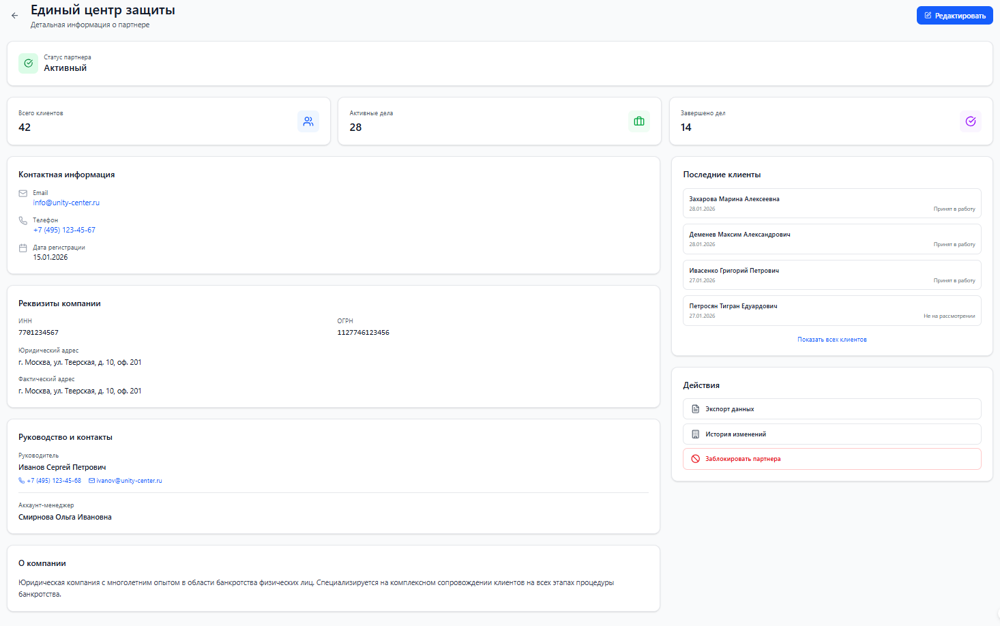
- Иконка «глаз» → просмотр профиля партнёра (тот же маршрут).
- Кнопка «три точки» → контекстное меню (дополнительные действия: изменить, заблокировать, удалить — по дальнейшей реализации).

**Как считается:**  

- Количество клиентов и активных дел берутся из полей партнёра (`clients`, `activeCases`).
- Статус и его цвет отображаются по `status` / `statusColor`.

**Если нет данных:**  

- При отсутствии партнёров или при фильтрации до пустого набора — пустая таблица с поясняющим текстом.

---


## 4. Настройки системы (`AdminSettings`)

### 4.1 — Общие настройки

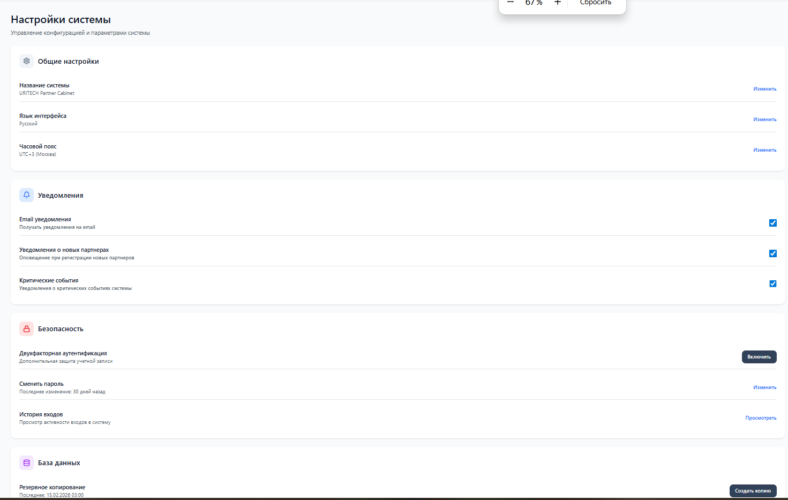

**Что показывает:**  

- Основные параметры системы:
  - «Название системы» (например, URITECH Partner Cabinet),
  - «Язык интерфейса»,
  - «Часовой пояс».
- Для каждого параметра — текущие значения и кнопка «Изменить».

**Чьи данные:**  

- Глобальные настройки системы URITECH (для всех пользователей).

**Куда ведёт:**  

- Кнопки **«Изменить»** открывают диалоги/формы изменения соответствующего параметра (в рамках экрана или модального окна).

**Как считается:**  

- Параметры хранятся в конфигурации системы и задаются администратором.

**Если нет данных:**  

- Используются значения по умолчанию, отображаемые в интерфейсе.

---

### 4.2 — Уведомления

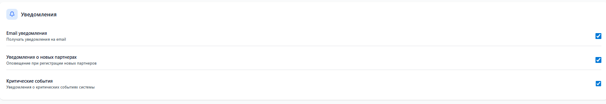

**Что показывает:**  

- Переключатели (чекбоксы) для включения/выключения системных уведомлений:
  - «Email уведомления» — получать уведомления на email,
  - «Уведомления о новых партнерах»,
  - «Критические события» — уведомления о критических инцидентах в системе.

**Чьи данные:**  

- Настройки уведомлений администратора (глобальные или персональные — по бизнес-правилу).

**Куда ведёт:**  

- Изменение чекбоксов сохраняет предпочтения уведомлений, влияющие на рассылку и события.

**Как считается:**  

- При включении/отключении чекбокса обновляются соответствующие настройки в профиле администратора или в системных настройках.

**Если нет данных:**  

- Все переключатели могут иметь состояние по умолчанию (например, включены).

---

### 4.3 — Безопасность

*(скриншот элемента)*

**Что показывает:**  

- Настройки, связанные с безопасностью учётной записи и системы:
  - «Двухфакторная аутентификация» (с кнопкой «Включить»),
  - «Сменить пароль» (с текстом о последнем изменении и кнопкой «Изменить»),
  - «История входов» (с кнопкой «Просмотреть»).

**Чьи данные:**  

- Параметры безопасности административной учётной записи и, опционально, системы в целом.

**Куда ведёт:**  

- Кнопка **«Включить»** → процесс настройки 2FA (например, через SMS/приложение).
- Кнопка **«Изменить»** → форма смены пароля.
- Кнопка **«Просмотреть»** → экран/модальное окно с журналом входов.

**Как считается:**  

- «Последнее изменение пароля» и другие данные берутся из журнала безопасности/профиля пользователя.

**Если нет данных:**  

- Для истории входов при её отсутствии — пустой список с заглушкой.

---

### 4.4 — База данных

*(скриншот элемента)*

**Что показывает:**  

- Блоки управления базой данных:
  - «Резервное копирование» — дата и время последнего бэкапа + кнопка «Создать копию»,
  - «Очистка данных» — описание (например, удаление устаревших записей) + кнопка «Выполнить».

**Чьи данные:**  

- Системные операции базы данных URITECH.

**Куда ведёт:**  

- Кнопка **«Создать копию»** запускает процедуру резервного копирования.
- Кнопка **«Выполнить»** запускает сценарий очистки данных (по заданным правилам: архивирование, удаление устаревших записей и т.д.).

**Как считается:**  

- Дата последнего бэкапа берётся из журнала системных операций.

**Если нет данных:**  

- Если бэкапов ещё не было — может отображаться «Нет данных» или «Резервное копирование не выполнялось».

---

## Как заполнять и расширять этот документ

### Шаг 1

Сделать скриншот экрана из Figma или работающего фронтенда → положить в `docs/screenshots/`.

### Шаг 2

Определить, в какую часть идёт экран:

- Экран для партнёра → **ЧАСТЬ 1**
- Экран для админа URITECH → **ЧАСТЬ 2**

### Шаг 3

Найти нужный раздел бокового меню (Дашборд, Клиенты, Задачи, Документы, Обучение, Чат, Финансы и т.д.) и добавить компоненты туда.

### Шаг 4

Разбить экран на блоки и для каждого ответить на вопросы по шаблону:

```markdown
### X.Y — Название блока

(скриншот элемента)

**Что показывает:** какие данные и что означает каждое число / текст.

**Чьи данные:** только свои / всех пользователей / конкретного клиента / и т.д.

**Куда ведёт:** что при клике, куда переход, что открывается.

**Как считается:** откуда числа, за какой период, кого считаем.

**Если нет данных:** что показывается при пустом результате.
```

Не все вопросы обязательны. Если блок — просто навигация или простая кнопка, достаточно **«Что показывает»** и **«Куда ведёт»**. Пропускайте неактуальные вопросы.