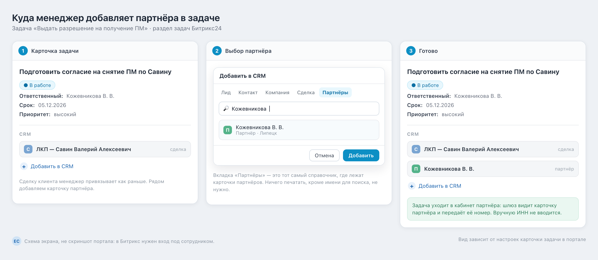

# Задачи из Битрикс24 в кабинете партнёра

Реализация ТЗ «Передача задач из Битрикс24 в ЛКП» (версия 1.0 от 27.11.2026).
Здесь описана приёмная сторона — то, что делает кабинет. Шлюз Битрикс24
разрабатывается отдельно силами ЮРИТЕХ.

## Что появилось в кабинете

* Задача, поставленная партнёру в Битриксе, приходит в раздел «Задачи от ЮРИТЕХ».
* Партнёр меняет только статус: «Взять в работу», «Выполнено», «Отклонить»
  с обязательной причиной.
* Каждое изменение статуса попадает в историю задачи и в отдельную ленту для шлюза.
* Просрочка вычисляется по сроку и не передаётся в Битрикс.
* Название, срок, описание и адресат в кабинете недоступны для правки: главная
  запись о задаче — в Битриксе.

## Адресат задачи

Менеджер прикрепляет карточку партнёра в штатном блоке «CRM» карточки задачи —
рядом со сделкой клиента. Шлюз видит привязку `T42e_<номер>` (тип смарт-процесса в шестнадцатеричном
виде) и передаёт номер карточки в кабинет. Отдельное поле в Битриксе не заводится.



| Ситуация | Ответ |
|---|---|
| Карточка привязана к одному аккаунту кабинета | задача создаётся |
| Карточка не привязана ни к одному аккаунту | `404 partner_not_found` |
| С карточкой связано несколько аккаунтов | `422 partner_ambiguous`, нужна ручная развязка |
| Пришли и карточка, и ИНН, но они про разных партнёров | `409 partner_mismatch` |
| Номер задачи уже привязан к другому партнёру | `409 task_partner_conflict` |

ИНН остаётся запасным способом: если шлюз передаёт только `inn`, кабинет ищет
партнёра по нему. Основной способ — `bitrix_id`: ИНН заполнен далеко не у всех
карточек партнёров (53 из 178 на 27.11.2026), а номер карточки есть всегда.

Задача без адресата в кабинет не отправляется — это ответственность шлюза.
Кабинет такой запрос отклонит как `400 invalid_payload`.

## POST /api/integration/tasks

Заголовки:

```
Content-Type: application/json
X-Integration-Token: <токен шлюза>
Idempotency-Key: bitrix-18591-2026-11-27T10:00:00+03:00
```

Тело — раздел 6 ТЗ, адресат задаётся номером карточки:

```json
{
  "bitrix_task_id": 18591,
  "bitrix_url": "https://bitrix.uriteh.ru/company/personal/user/44/tasks/task/view/18591/",
  "title": "Выдать разрешение на получение ПМ",
  "description": "Должник Савин, оформлена самозанятость",
  "deadline": "2026-12-30T23:59:00+03:00",
  "priority": "high",
  "status": "new",
  "partner": { "bitrix_id": 777 },
  "client": { "name": "Савин Валерий Алексеевич", "deal_id": 410 },
  "author": { "name": "Евгений Самсонюк", "user_id": 57 },
  "created_at": "2026-11-20T10:00:00+03:00",
  "updated_at": "2026-11-27T10:00:00+03:00"
}
```

Дополнительно кабинет проверяет:

* `bitrix_url` — только `https` и только хост `BITRIX_ALLOWED_DOMAIN`;
* `deadline`, `created_at`, `updated_at` — ISO 8601 с часовым поясом;
* `title` — непустой, до 255 символов;
* `description` — до 20 000 символов, простой текст;
* `partner.bitrix_id` — номер карточки партнёра (основной ключ);
* `partner.inn` — 10 или 12 цифр (запасной ключ); нужен хотя бы один из двух.

Ответы:

| Код | Тело | Смысл |
|---|---|---|
| 201 | `{"lkp_task_id": "...", "status": "new"}` | задача создана |
| 200 | то же | задача уже была и обновлена либо это повтор без изменений |
| 400 | `{"error": "invalid_payload", "detail": "..."}` | некорректные данные |
| 401 | `{"error": "unauthorized"}` | неверный токен |
| 404 | `{"error": "partner_not_found"}` | карточка или ИНН не привязаны к аккаунту кабинета |
| 409 | `{"error": "stale_update"}` | пришло изменение старше сохранённого |
| 409 | `{"error": "partner_mismatch"}` | карточка и ИНН указывают на разных партнёров |
| 409 | `{"error": "task_partner_conflict"}` | номер задачи уже у другого партнёра |
| 422 | `{"error": "partner_ambiguous"}` | с адресатом связано несколько аккаунтов |
| 429 | тело slowapi | превышен лимит запросов |
| 503 | `{"error": "integration_disabled"}` | токен не настроен на сервере |

Разрешение конфликтов: применяется запрос с более поздним `updated_at`.
Равный `updated_at` считается повтором: ответ 200 без изменений, чтобы не
перетереть уже сделанное партнёром действие.

Ключ идемпотентности — `bitrix_task_id`: повторная доставка обновляет задачу,
второй строки в базе не появляется (частичный уникальный индекс в PostgreSQL).

## GET /api/integration/tasks/changes

```
GET /api/integration/tasks/changes?since=2026-11-27T10:00:00%2B03:00&limit=200
X-Integration-Token: <токен шлюза>
```

Ответ:

```json
{
  "items": [
    {
      "bitrix_task_id": 18591,
      "lkp_task_id": "4567",
      "status": "done",
      "changed_at": "2026-11-27T10:05:00+03:00",
      "author_name": "Ангелина Савина",
      "reject_reason": null
    }
  ],
  "next_since": "2026-11-27T10:05:00+03:00"
}
```

* `limit` — 200 по умолчанию, максимум 500.
* Без `since` возвращается пустой список и текущее время.
* В ленту попадают только изменения со стороны кабинета. Иначе шлюз получил бы
  эхо собственных обновлений и зациклил применение.
* История хранится в таблице `bitrix_task_status_changes`, поэтому потеря
  `next_since` не теряет изменения: шлюз просто запросит более ранний `since`.
* `status` — `in_progress`, `done` или `rejected`. «Просрочено» не передаётся.

## Статусы

| Битрикс | Код | В кабинете | Лента шлюзу |
|---|---|---|---|
| Ждёт выполнения | 2 | `pending` («Ожидает») | — |
| Выполняется | 3 | `in_progress` | `in_progress` |
| Ждёт контроля | 4 | `in_progress` | — |
| Завершена | 5 | `completed` | `done` |
| Отложена | 6 | `pending` | — |
| Отклонена | 7 | `rejected` | возврат в работу (2) + метка и причина |

Коды в разделе 7 ТЗ перепутаны: на портале 2 — «Ждёт выполнения»,
3 — «Выполняется», 4 — «Ждёт контроля» (проверено по карточке задачи 27.11.2026).
Шлюз сопоставляет коды по фактическим названиям, поэтому на приём это не влияет.
| — | — | `overdue` (по сроку) | не передаётся |

`completed` и `rejected` — финальные: просрочка по ним не считается.

**Статус «Отклонена» (7) через REST недостижим.** На портале 27.11.2026 он не
используется ни у одной задачи; действие «Отклонить» возвращает задачу в
работу (статус 2), а прямая смена статуса на 7 отклоняется. Поэтому отказ
партнёра шлюз передаёт так: задача возвращается в «Новую», получает метку
«Отклонено партнёром» и комментарий с причиной. Кабинет при этом показывает
«Отклонено». Это расхождение с таблицей раздела 7 ТЗ зафиксировано осознанно.

## Действия партнёра

`POST /api/v1/tasks/{id}/status` (обычная авторизация партнёра, не токен шлюза):

```json
{ "status": "rejected", "reject_reason": "Нет доверенности от должника" }
```

* Допустимые переходы: ожидает → в работе / выполнено / отклонено;
  в работе → выполнено / отклонено; выполнено и отклонено → в работу.
* Повторное нажатие того же статуса — успех без нового изменения в ленте.
* Отклонение без причины — 422.
* Чужая задача — 404 (не подтверждаем существование).

## Просрочка

Просрочка — вычисляемое состояние по `due_at` (или `due_date` в московском
времени), а не отдельный статус. Автоматически подсвечивается в списке,
попадает в счётчик «Просрочено» и в фильтр. В Битрикс не передаётся.

## Уведомления

* Новая задача — партнёру.
* Задача изменена в Битриксе (смена статуса или срока) — партнёру.
* За день до срока — партнёру (фоновая задача Celery, раз в час, без дублей).
* Просрочка — партнёру и активным администраторам (однократно).
* Отклонение партнёром — администраторам, чтобы перевыпустить задачу.
* Завершение партнёром — без уведомления: при закрытии задачи Битрикс уведомит
  постановщика сам (раздел 12 ТЗ).

## Настройки

| Переменная | Смысл |
|---|---|
| `BITRIX_INTEGRATION_TOKEN` | токен шлюза; пусто = приём выключен (503) |
| `BITRIX_INTEGRATION_RATE_LIMIT` | лимит запросов, по умолчанию `600/minute` |
| `BITRIX_INTEGRATION_LINK_BASE` | путь раздела задач для ссылок в уведомлениях |

## Решения по разделу 15 ТЗ

1. **Сотрудники партнёра.** Задача адресуется компании: её видят все
   пользователи этого партнёра. Уведомления уходят владельцу учётной записи
   партнёра. Персональная адресация — вторая версия.
2. **Несколько аккаунтов на одного партнёра.** Передача блокируется
   (`partner_ambiguous`), пока администратор не развяжет дубли.
   Автоматическое сведение опасно: можно отдать задачу не тому юристу.
3. **Файл при закрытии.** Не входит в первую версию (раздел 3 ТЗ). Партнёр
   закрывает задачу статусом, результат присылает в обсуждении задачи.

## Что нужно на стороне шлюза

1. Читать у задачи `UF_CRM_TASK` и брать оттуда:
   * `D_<номер>` — сделка клиента;
   * `T42e_<номер>` — карточка партнёра (смарт-процесс «Партнёры», тип 1070).
2. Если `T42e_` нет — задачу в кабинет не отправлять, оставить обычной
   задачей Битрикса.
3. Передавать номер карточки в `partner.bitrix_id`. ИНН можно не передавать.

Отдельное поле «Партнёр (ЛКП)» не нужно: через REST его нельзя ограничить
смарт-процессом партнёров (доступны только лид, контакт, компания и сделка),
а штатного блока «CRM» достаточно. Проверено на портале 27.11.2026.
