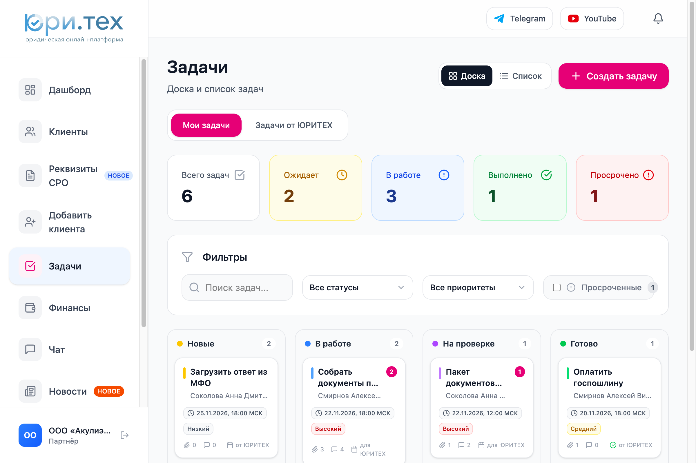
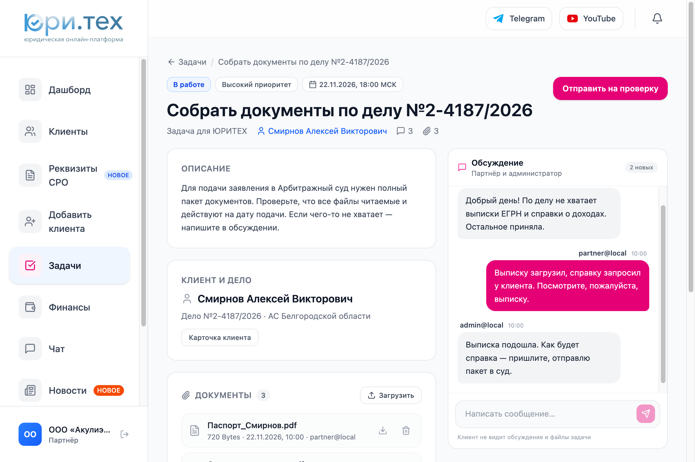

# Задачи: документы и обсуждение

Реальная доработка кабинета: задача становится рабочим пространством, а не только
строкой в списке.

## Что добавлено

- Карточка задачи `/dashboard/tasks/:id` и `/admin/tasks/:id`.
- Ширина обсуждения регулируется перетаскиванием вертикальной границы между
  задачей и чатом; значение запоминается. Двойной клик по границе возвращает
  исходную ширину, стрелки клавиатуры двигают её по 24 px.
- Доска и список на странице задач; доска включена по умолчанию у партнёра,
  список — у администратора.
- Документы задачи до 50 МБ: PDF, DOC/DOCX, XLS/XLSX, JPG/JPEG, PNG, HEIC.
- Один файл хранится в `task_files` и виден одновременно в задаче и в карточке
  клиента. Это одна запись, а не копия.
- Обсуждение внутри задачи. Оно не попадает в общий «Чат» и не дублируется:
  у задачи отдельный тред, у общего чата — свои комнаты.
- История задачи: создание, статусы, проверка, загрузка и удаление файлов.
- Задачи идут в обе стороны: от партнёра к ЮРИТЕХ и от ЮРИТЕХ к партнёру.
  Проверка нужна только во втором случае, когда исполнитель — партнёр.

## Два направления

### Партнёр → ЮРИТЕХ

Партнёр создаёт задачу, ЮРИТЕХ её выполняет.

- «Новая» — партнёр передал, администратор ещё не взял;
- «В работе» — администратор взял задачу;
- «Готово» — администратор выполнил.

Проверки со стороны администратора здесь нет: он сам исполнитель. Партнёр видит
статус, документы и обсуждение.

### ЮРИТЕХ → партнёр

Администратор ставит задачу партнёру, партнёр её выполняет.

- «Новая» — задача у партнёра;
- «В работе» — партнёр взял задачу;
- «На проверке» — партнёр закончил, администратор принимает результат;
- «Готово» — администратор принял.

Только здесь используется проверка: администратор — заказчик, а не исполнитель.
Он может завершить задачу или вернуть её в работу.

## Модель проверки

Новый статус в `tasks.status` не добавлялся, чтобы не ломать проекцию в Битрикс24.
Вместо этого используются поля:

- `review_requested_at` — задача отправлена на проверку;
- `review_requested_by` — кто отправил.

«На проверке» — вычисляемое состояние: `status = in_progress`, заполнен
`review_requested_at` и `assigned_to = partner`. Для задач, где исполнитель —
ЮРИТЕХ, проверка недоступна. При завершении администратором задача переходит в
`completed`; при возврате — обратно в `in_progress`, поля проверки очищаются.
В Битрикс24 уходит только фактическая смена статуса (`completed` / `in_progress`),
поэтому промежуточная проверка не создаёт лишних событий.

## Права

- Партнёр видит только задачи своей компании.
- Администратор видит все задачи и может фильтровать по партнёру.
- Партнёр может отправлять на проверку только задачу, где он исполнитель
  (`assigned_to = partner`).
- Администратор завершает задачи, где исполнитель — ЮРИТЕХ, и принимает задачи,
  где исполнитель — партнёр.
- Файл удаляет автор или администратор.
- Клиент не видит задачи, обсуждение и файлы.

## API

- `GET /api/v1/tasks/{id}` — карточка, файлы, сообщения, история, права.
- `GET/POST /api/v1/tasks/{id}/files`, `GET .../files/{file_id}/download`,
  `DELETE .../files/{file_id}`.
- `GET/POST /api/v1/tasks/{id}/messages`.
- `POST /api/v1/tasks/{id}/review` с действием `request | approve | return`.
- `GET /api/v1/tasks/client-files/{client_id}` — документы задач для карточки клиента.

## Хранение

Файлы задачи лежат в S3 через существующий `s3_service`, метаданные — в
`task_files`. Скачивание идёт через API с проверкой доступа, без публичной ссылки.

## Миграция

`alembic/versions/f3a7c9e1b204_task_workspace.py`:
поля проверки в `tasks`, таблицы `task_files`, `task_messages`, `task_events`,
`task_read_states`.

`alembic/versions/e4c8b2d7a901_tasks_missing_projection_columns.py`:
repair-миграция. На чистой базе в старой цепочке не хватало `tasks.partner_id`,
`due_at`, `bitrix_imported`, `bitrix_published`, хотя ORM их уже использует.
`IF NOT EXISTS` делает миграцию безопасной для продакшена, где эти поля уже есть.
На тестовой Postgres обе миграции применились, после чего загрузка в S3,
скачивание, карточка клиента и проверка задачи прошли.

`alembic/versions/b8d4c2e7f901_relax_optional_task_fields.py`:
снимает устаревшие `NOT NULL` с `tasks.client_id` и `tasks.due_date`. ORM давно
допускает задачи без клиента и срока; на чистой базе ограничения мешали.

## Проверка на тестовом контуре

Изолированный локальный контур: PostgreSQL 15, Redis 7 и S3-совместимое
хранилище (moto) в Docker/локальном процессе. На нём прошли:

- миграции с чистой базы;
- вход партнёра и администратора;
- загрузка PDF в S3, скачивание, файл в задаче и в карточке клиента;
- удаление файла и исчезновение из обоих мест;
- сообщение в обсуждении задачи;
- отправка на проверку партнёром и завершение администратором;
- изоляция: второй партнёр видит только свою задачу, чужой получает 403;
- доска и карточка задачи в браузере без ошибок.

## Что осталось за рамками итерации

- Общий чат не показывает треды задач — по продуктовому решению.
- Файлы и обсуждение задачи пока не синхронизируются в Битрикс24.
- Push/WebSocket для сообщений задачи: сейчас опрос раз в 3 секунды.
- Массовые действия и чек-листы не добавлялись.
